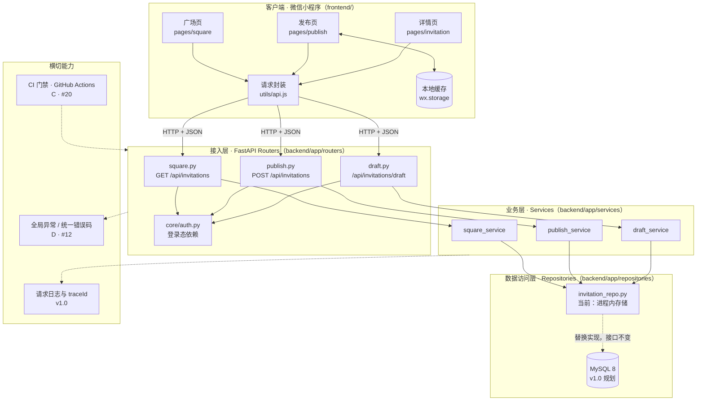
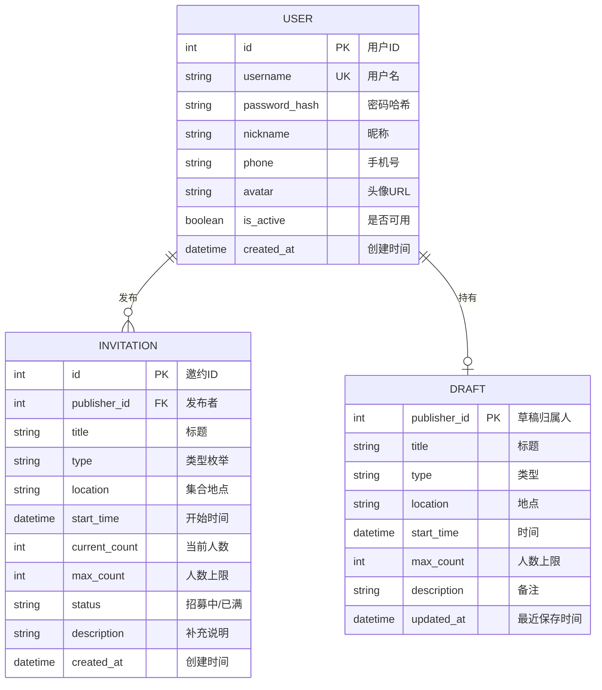
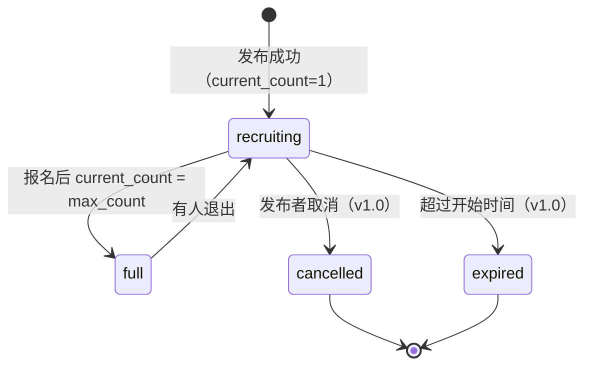
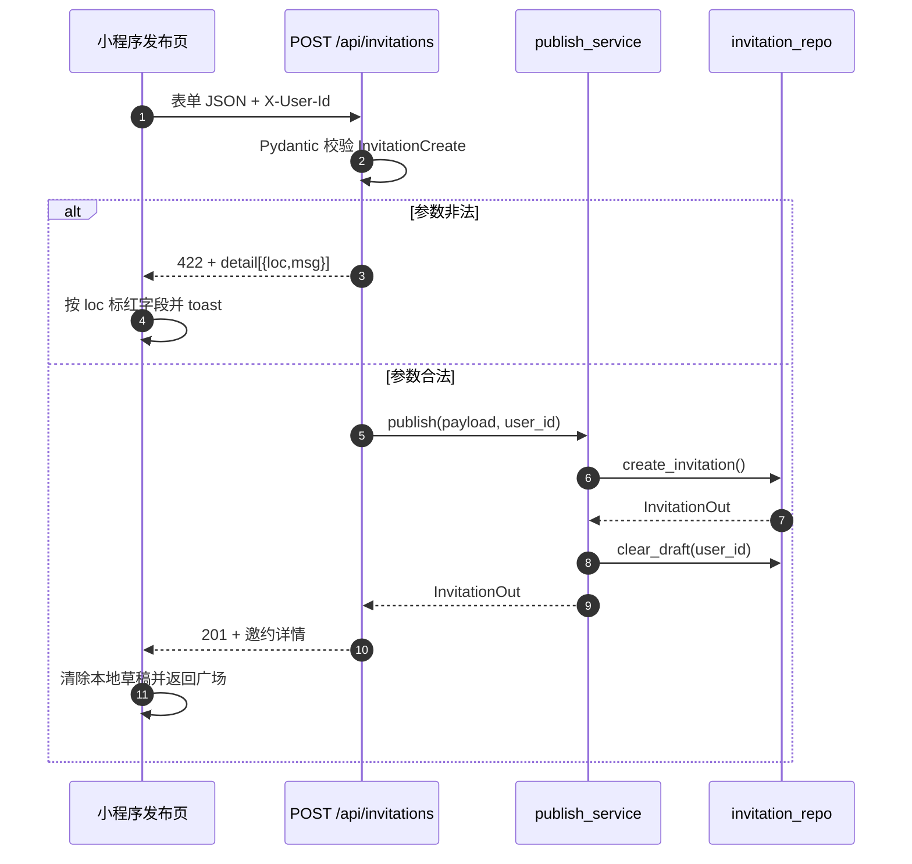
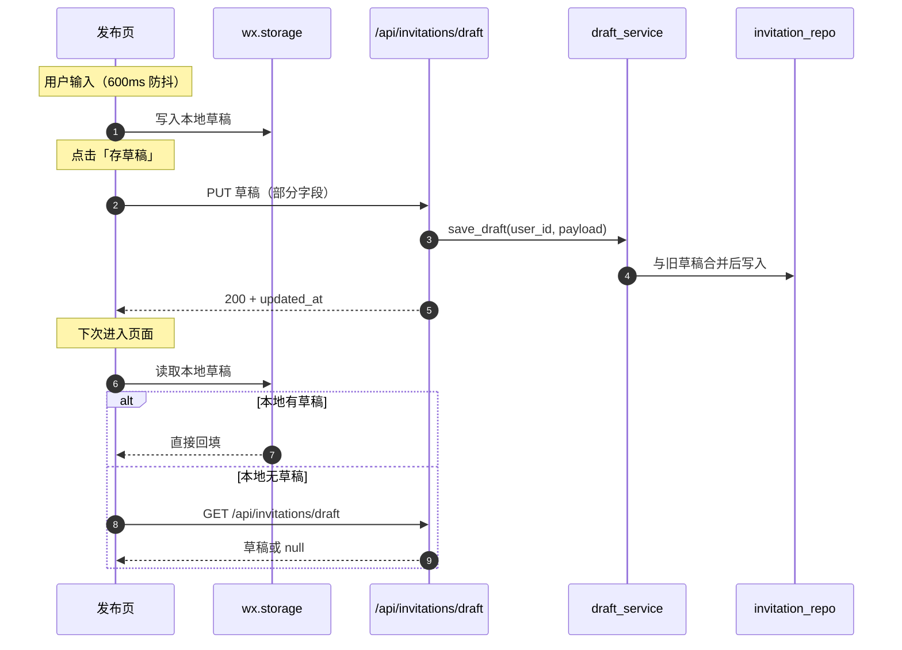
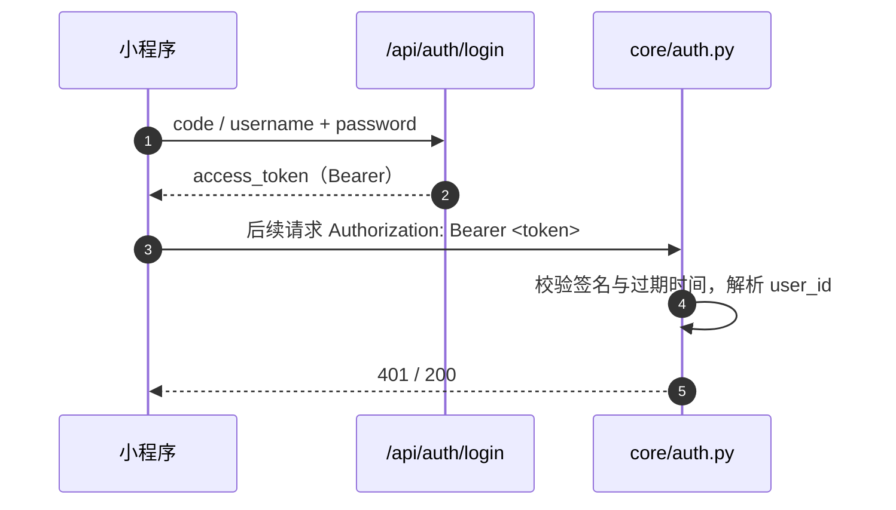
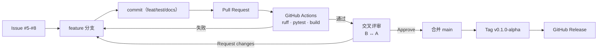

# 校园搭子小程序 · 架构设计文档

| 项目 | 内容 |
| --- | --- |
| 文档版本 | v0.1（对应里程碑 `v0.1.0-alpha`） |
| 编写人 | 组员 B · 宋沛蕾（GitHub: @kindly-cs） |
| 评审人 | 何佳欣（A）、何佳宇（C）、蓝海欣（D） |
| 更新日期 | 2026-11-05 |
| 关联 Issue | #8（本文档）、#5 / #6（发布与草稿）、#16 / #18（广场）、#11 / #12（状态与异常） |
| 状态 | 随 Alpha 代码同步维护，答辩前冻结 |

> 本文所有图表均使用 Mermaid 源码内嵌，随仓库一起版本化管理，不依赖外部图片。

---

## 1. 背景与范围

### 1.1 产品目标

「校园搭子」面向在校大学生，解决“想做的事找不到人一起”的问题：用户发布一条搭子邀约（学习、运动、约饭、出行、其他），其他同学在广场浏览、筛选、查看详情并报名，人数达到上限后邀约自动变为「已满」。

### 1.2 本期（Alpha）范围

| 优先级 | 功能 | 对应 Issue | 负责人 |
| --- | --- | --- | --- |
| P0 | 登录注册、个人主页 | #2 / #3 | A |
| P0 | 发布搭子邀约（含表单校验） | #5 / #7 | B |
| P0 | 草稿暂存 | #6 | B |
| P0 | 邀约广场（分页、类型筛选） | #16 / #19 | C |
| P0 | 邀约详情 | #18 / #19 | C |
| P0 | 邀约状态（招募中 / 已满）、人数上限 | #11 / #13 | D |
| P0 | 全局异常与统一错误码 | #12 / #13 | D |
| P1 | 架构文档、会议记录、Release | #8 / #14 | B / D |

**本期不做（延后到 v1.0）**：私聊、点赞收藏、智能匹配、消息推送、支付。

### 1.3 架构约束

1. **时间**：4 人 × 约 2 天完成可演示版本，架构必须“能被 4 个人同时改动而不互相阻塞”。
2. **人力**：无专职运维，不引入需要长期维护的中间件（Redis、消息队列、K8s）。
3. **端**：微信小程序原生运行时，不能依赖浏览器 DOM。
4. **验收**：中期检查要求可运行、可测试、有 CI、有文档，代码量不是首要目标。

---

## 2. 架构原则

| 原则 | 落地方式 |
| --- | --- |
| 分层解耦 | 路由（协议）→ 服务（业务）→ 仓储（存储），每层只依赖下一层的接口 |
| 契约先行 | 请求/响应结构统一由 Pydantic 模型定义，前后端按同一份字段名联调 |
| 服务端可信 | 状态、人数、发布者等字段由服务端赋值，客户端传入一律忽略 |
| 可测试 | 业务逻辑不依赖数据库连接，仓储可替换为内存实现，接口用 `TestClient` 直测 |
| 渐进演进 | Alpha 用内存仓储跑通链路，v1.0 替换为 MySQL 时保持仓储函数签名不变 |
| 小步提交 | 一 Issue 一分支一 PR，CI 全绿才允许合并 |

---

## 3. 总体架构

### 3.1 分层架构图



**读图说明**

- 小程序端不直接拼 SQL、不信任本地状态：所有写操作都经 `utils/api.js` 统一加身份头、统一处理非 2xx。
- 路由层只做“HTTP 语义 ↔ 领域对象”的转换：解析路径/请求头、调用服务、返回模型。
- 服务层承载业务规则（发布后清草稿（#6）、草稿合并、状态流转）。
- 仓储层是唯一知道数据存在哪里的地方；Alpha 用列表/字典，v1.0 换 MySQL 时上层零改动。

### 3.2 目录与职责映射

```text
Campus-mate/
├── backend/
│   ├── app/
│   │   ├── main.py                 # 应用装配：注册路由、健康检查
│   │   ├── core/auth.py            # 登录态依赖（Alpha 用 X-User-Id 过渡）
│   │   ├── routers/                # 接入层
│   │   │   ├── square.py           # 广场列表 / 详情（C）
│   │   │   ├── publish.py          # 发布邀约（B · #5）
│   │   │   └── draft.py            # 草稿箱（B · #6）
│   │   ├── services/               # 业务层
│   │   │   ├── square_service.py
│   │   │   ├── publish_service.py  # 发布后清理草稿（#6，B）
│   │   │   └── draft_service.py    # 草稿保存/读取/丢弃（B）
│   │   ├── repositories/
│   │   │   └── invitation_repo.py  # 邀约与草稿存储（C 建，B 扩展写接口）
│   │   └── schemas/
│   │       └── invitation.py       # 邀约 + 发布 + 草稿模型（B）
│   ├── tests/                      # pytest + TestClient
│   └── requirements.txt
├── frontend/                       # 微信小程序原生
│   ├── pages/{square,publish,invitation}/
│   └── utils/api.js                # request / requestAsUser
├── docs/
│   ├── architecture.md             # 本文档
│   ├── SRS.md                      # 需求规格说明书
│   └── meetings/meeting-01.md      # 第一次会议记录
└── .github/workflows/ci.yml        # lint + test + build 门禁
```

---

## 4. 技术选型与 ADR

### 4.1 决策总览

| 编号 | 决策点 | 结论 | 主要理由 | 复审时机 |
| --- | --- | --- | --- | --- |
| ADR-001 | 后端框架 | FastAPI | 自带 OpenAPI、类型友好、起步成本低 | v1.0 若需复杂权限体系再评估 |
| ADR-002 | 入参校验 | Pydantic v2 | 与 FastAPI 同源，模型即文档 | — |
| ADR-003 | 数据存储 | 内存仓储先行 → MySQL | 2 天内免部署；接口隔离保证可替换 | Alpha 结束 / 数据需持久化时 |
| ADR-004 | 前端形态 | 微信小程序原生 | 无构建链、评审可直接读代码 | 需要多端复用时考虑 uni-app |
| ADR-005 | 身份传递 | `X-User-Id` 过渡 → Bearer Token | 登录模块（#2）未合入，先解耦联调 | #2 合入时立即替换 |
| ADR-006 | 错误响应 | FastAPI 标准 422 → 统一错误码 | 先保证字段级报错，D 的 #12 统一封装 | #12 合入时 |
| ADR-007 | 分支与发布 | trunk + feature 分支 + PR + CI | 4 人并行且可追溯，满足考核 A4/A5/A6 | 团队规模变化时 |

### 4.2 ADR-001：后端选择 FastAPI

- **背景**：4 人只有 2 天，需要同时满足“接口可联调、可自动测试、可生成接口文档”。
- **备选**：Flask（生态大但需自己搭校验/文档）、Django（全家桶过重）、Node/Express（组内 Python 更熟）。
- **决策**：FastAPI + Uvicorn。
- **理由**：Pydantic 模型同时承担校验、序列化和文档；`TestClient` 让接口测试无需起服务；自动生成 `/docs` 便于答辩演示。
- **代价**：异步生态与传统 Django 不同，组员需要熟悉依赖注入写法；已通过统一目录模板降低学习成本。
- **复审**：当出现长事务、复杂权限或需要服务拆分时重新评估。

### 4.3 ADR-002：Pydantic v2 作为唯一校验入口

- **决策**：所有外部输入（body、query、header）必须经过 Pydantic 模型；业务层不再做类型判断。
- **理由**：避免“前端校验通过、后端仍写入脏数据”；错误定位到字段（`loc`），前端可直接标红。
- **实现要点**：
  - `StringConstraints(strip_whitespace=True, min_length=..., max_length=...)` 保证“先 trim 再判长度”；
  - `field_validator` 处理跨字段/时间窗口规则（如开始时间必须在未来 30 天内）；
  - 请求模型只暴露用户可填字段，`status`、`current_count`、`publisher_id` 不接受客户端输入。

### 4.4 ADR-003：内存仓储先行，MySQL 后置

- **背景**：中期检查前没有服务器和数据库运维预算，但接口契约必须稳定。
- **决策**：`repositories/invitation_repo.py` 以模块级列表/字典实现；对上层只暴露函数，不暴露数据结构。
- **迁移路径**：v1.0 新增 `invitation_repo_sql.py`，用 SQLAlchemy 实现同一组函数，`services` 只改 import。
- **代价**：服务重启数据丢失；已在 README/答辩脚本中标注“演示数据每次重置”。
- **风险控制**：写接口集中在此文件，替换时影响面可控（当前仅 `publish_service` / `draft_service` / `square_service`）。

### 4.5 ADR-004：微信小程序原生开发

- **备选**：uni-app（Vue 语法、可多端）、Taro（React）。
- **决策**：原生 WXML/WXSS/JS。
- **理由**：无需 Node 构建链，CI 只需 `node --check`；4 人可直接在微信开发者工具中预览；减少“构建失败”这一中期风险。
- **代价**：无法复用到 H5；组件生态弱。v1.0 若要做 Web 端再评估 uni-app。

### 4.6 ADR-005：登录态过渡方案

- **现状**：登录接口（#2）尚未合入，但发布/草稿接口需要“当前用户”。
- **决策**：新增 `core/auth.py` 的 `get_current_user_id()` 依赖，Alpha 从 `X-User-Id` 请求头读取；前端 `utils/api.js` 统一附带。
- **替换方式**：#2 合入后，将该函数改为解析 `Authorization: Bearer <token>` 并返回 user_id；路由与服务层签名不变。
- **安全说明**：该方案仅用于本地/演示环境，**不得在生产环境启用**；中期答辩时明确说明这是过渡实现。

### 4.7 ADR-006：错误响应演进

- **Alpha 现状**：参数错误返回 FastAPI 标准 `422`，结构为 `{"detail":[{loc,msg,type}]}`，前端按 `loc` 定位字段。
- **目标**：D 的 #12 引入统一错误码（如 `40001 参数校验失败`）与统一响应包装，前端只需判断 `code`。
- **兼容策略**：先保证 4xx/5xx 语义正确，再统一包装；B 的测试断言字段级 `loc`，包装后仍保留 `errors` 数组即可平滑迁移。

### 4.8 ADR-007：分支、评审与发布

- `main` 开启保护：禁止直推、至少 1 个 Approve、CI 必须通过。
- 一人一分支：`feature/<成员>-<模块>`；一个 Issue 至少一个 commit，commit message 使用 `feat/fix/docs/chore/test` 前缀。
- 固定评审环：A 评 D、D 评 C、C 评 B、B 评 A；禁止自评自合。
- 合并后由 D 打 `v0.1.0-alpha` Tag 并发布 Release。

---

## 5. 数据模型

### 5.1 ER 图



> Alpha 阶段 `DRAFT` 存在进程内字典中（`_DRAFTS`），`INVITATION` 存在列表中；字段与上表一致，迁移 MySQL 时按此建表。

### 5.2 邀约字段与约束

| 字段 | 类型 | 约束 | 由谁赋值 |
| --- | --- | --- | --- |
| `id` | int | 自增，唯一 | 服务端 |
| `publisher_id` | int | 必须为当前登录用户 | 服务端（来自登录态） |
| `title` | string | trim 后 4–30 字 | 用户 |
| `type` | enum | `study/sport/food/travel/other` | 用户 |
| `location` | string | trim 后 2–50 字 | 用户 |
| `start_time` | datetime | 晚于当前时间，最多提前 30 天 | 用户 |
| `current_count` | int | ≥1，发布时固定为 1 | 服务端 |
| `max_count` | int | 2–20 | 用户 |
| `status` | enum | `recruiting/full`，发布时为 `recruiting` | 服务端 |
| `description` | string? | ≤500 字 | 用户 |
| `created_at` | datetime | 服务端时间（UTC） | 服务端 |

### 5.3 状态机



> Alpha 只实现 `recruiting ↔ full`（#11）；`cancelled/expired` 在 v1.0 补充，避免中期范围膨胀。

### 5.4 草稿规则

1. 每个用户同时**只保留一份**草稿（`_DRAFTS` 以 `publisher_id` 为键）。
2. 保存采用**增量合并**：本次未提交的字段保留上次值，显式传空字符串可清空。
3. 草稿不进入广场、不可被其他用户读取。
4. 发布成功后自动清除该用户草稿（由 #6 的 `publish_service.publish()` 调用 `clear_draft()` 实现），避免“已发布仍提示继续编辑”。

---

## 6. 关键流程

### 6.1 发布邀约



### 6.2 草稿保存与恢复



**为什么本地优先**：弱网/后端未启动时仍能保住用户输入；服务端草稿用于换设备/清缓存后的恢复。

### 6.3 登录态（目标态）



> 当前为过渡态：`X-User-Id` 直接传用户 id，仅本地演示使用（见 ADR-005）。

---

## 7. API 设计

### 7.1 通用约定

| 项 | 约定 |
| --- | --- |
| 前缀 | `/api`；健康检查 `/health` |
| 编码 | `application/json; charset=utf-8` |
| 命名 | 字段 `snake_case`，与 Pydantic 模型一致 |
| 时间 | ISO-8601 **必须带时区**（`Z` 或 `+08:00`）；服务端校验后统一转 UTC 存储，客户端负责本地化展示 |
| 鉴权 | 目标：`Authorization: Bearer <token>`；Alpha 过渡：`X-User-Id` |
| 分页 | `page` 从 1 开始，`page_size` 1–50，响应含 `total/page/page_size/list` |
| 错误 | 4xx/5xx + 结构化错误体；参数错误定位到字段 |

参数错误示例（Alpha，FastAPI 标准 422）：

```json
{
  "detail": [
    {
      "type": "string_too_short",
      "loc": ["body", "title"],
      "msg": "String should have at least 4 characters",
      "input": "abc"
    }
  ]
}
```

### 7.2 接口清单

| 方法 | 路径 | 说明 | 负责人 | Issue | 状态 |
| --- | --- | --- | --- | --- | --- |
| POST | `/api/auth/register` | 注册 | A | #2 | 规划中 |
| POST | `/api/auth/login` | 登录，返回令牌 | A | #2 | 规划中 |
| GET | `/api/users/me` | 当前用户资料 | A | #2 | 规划中 |
| PUT | `/api/users/me` | 修改昵称/头像 | A | #2 | 规划中 |
| GET | `/api/invitations` | 广场分页 + 类型筛选 | C | #16 | ✅ 已实现 |
| GET | `/api/invitations/{id}` | 邀约详情 | C | #18 | ✅ 已实现 |
| POST | `/api/invitations` | 发布邀约 | B | #5 | ✅ 已实现 |
| GET | `/api/invitations/draft` | 读取当前草稿 | B | #6 | ✅ 已实现 |
| PUT | `/api/invitations/draft` | 保存当前草稿（增量） | B | #6 | ✅ 已实现 |
| DELETE | `/api/invitations/draft` | 丢弃当前草稿 | B | #6 | ✅ 已实现 |
| POST | `/api/invitations/{id}/join` | 报名（校验人数上限） | D | #11 | 规划中 |
| PATCH | `/api/invitations/{id}/status` | 状态流转 | D | #11 | 规划中 |
| GET | `/health` | 健康检查 | C | #20 | ✅ 已实现 |

### 7.3 发布邀约（B · #5）

`POST /api/invitations`，请求头 `X-User-Id: <int>`（过渡）。

请求体：

```json
{
  "title": "周末羽毛球搭子",
  "type": "sport",
  "location": "东区体育馆",
  "start_time": "2026-11-06T11:00:00.000Z",
  "max_count": 4,
  "description": "水平不限，主要想活动一下。"
}
```

成功响应 `201`：

```json
{
  "id": 9,
  "title": "周末羽毛球搭子",
  "type": "sport",
  "location": "东区体育馆",
  "start_time": "2026-11-06T11:00:00Z",
  "current_count": 1,
  "max_count": 4,
  "status": "recruiting",
  "publisher_id": 9001,
  "description": "水平不限，主要想活动一下。",
  "created_at": "2026-11-05T08:00:00Z"
}
```

校验规则（服务端为准）：

| 字段 | 规则 | 失败表现 |
| --- | --- | --- |
| `title` | trim 后 4–30 字 | 422，`loc=["body","title"]` |
| `type` | 5 种枚举之一 | 422 |
| `location` | trim 后 2–50 字 | 422 |
| `start_time` | 晚于当前时间且 ≤30 天 | 422，中文提示 |
| `max_count` | 2–20 整数 | 422 |
| `description` | ≤500 字，可空 | 422 |

### 7.4 草稿箱（B · #6）

| 操作 | 请求 | 成功响应 |
| --- | --- | --- |
| 读取 | `GET /api/invitations/draft` | `200` + 草稿对象，或 `null` |
| 保存 | `PUT /api/invitations/draft` | `200` + 草稿对象（含 `updated_at`） |
| 丢弃 | `DELETE /api/invitations/draft` | `204`，幂等 |

保存请求体（所有字段可选，只提交本次改动即可）：

```json
{ "title": "周五晚上剧本杀", "location": "北门剧本杀店" }
```

---

## 8. 错误码规划（D · #12）

Alpha 阶段先使用 HTTP 语义；#12 合入后统一为：

| code | HTTP | 含义 | 前端处理 |
| --- | --- | --- | --- |
| 0 | 200 | 成功 | 正常渲染 |
| 40001 | 400/422 | 参数校验失败 | 按 `errors[].field` 标红 |
| 40101 | 401 | 未登录 / 令牌失效 | 跳转登录页 |
| 40301 | 403 | 无权操作 | toast + 返回 |
| 40401 | 404 | 资源不存在 | 空状态页 |
| 40901 | 409 | 状态冲突（如重复报名、已满） | toast 并刷新详情 |
| 50000 | 500 | 服务端异常 | 兜底错误页 |

---

## 9. 非功能性设计

| 维度 | 目标 | 当前实现 | 后续 |
| --- | --- | --- | --- |
| 性能 | 列表接口 P95 < 300ms（≤1k 条数据） | 内存过滤，O(n) | MySQL 索引 `(status, type, start_time)` |
| 安全 | 不信任客户端；无越权读写 | 服务端赋值状态/人数；草稿按用户隔离；Pydantic 白名单 | 密码哈希、令牌签名、越权测试 |
| 可用性 | 弱网可保存草稿 | 本地草稿 + 服务端草稿双写 | 失败重试队列 |
| 可观测 | 能定位一次请求 | 请求日志（v1.0 traceId） | 统一日志格式 |
| 隐私 | 不展示手机号全量 | 详情仅展示昵称/头像 | 手机号脱敏 |
| 合规 | 不采集无关个人信息 | 仅昵称、头像、校园 | 隐私协议（v1.0） |

---

## 10. 测试策略

### 10.1 分层

| 层级 | 工具 | 覆盖内容 | 门禁 |
| --- | --- | --- | --- |
| 单元/接口 | pytest + `TestClient` | 路由、校验、业务规则、仓储读写 | CI 必跑 |
| 覆盖率 | pytest-cov | `backend/app` ≥ 40% | CI `--cov-fail-under=40` |
| 前端语法 | `node --check` | 全部小程序 JS | CI 必跑 |
| 手工联调 | 微信开发者工具 + 本地 API | 表单交互、草稿恢复、空/错状态 | 提交前全组走查 |

### 10.2 B 模块用例（`backend/tests/`）

| 用例 | 断言点 |
| --- | --- |
| 未登录发布 | 401，不落库 |
| 正常发布 | 201，`status=recruiting`，`current_count=1`，广场首位可见 |
| 伪造 `status/current_count` | 被忽略，仍为招募中/1 人 |
| 标题过短 / 过长 / 前后空格 | 422，`loc` 指向 `title` |
| 开始时间过去 / 超过 30 天 | 422，中文提示 |
| 人数上限 1 / 21 | 422 |
| 非法类型 / 超长备注 | 422 |
| 发布后清草稿 | `GET draft` 返回 `null` |
| 草稿部分保存 / 合并 / 清空 | 字段保留或清空符合预期 |
| 草稿用户隔离 | 他人读取为 `null` |
| 草稿不进入广场 | 列表不含草稿标题 |
| 删除草稿幂等 | 两次 DELETE 均 204 |

---

## 11. CI/CD 与协作流程



- `ci.yml`：安装依赖 → `ruff check app tests` → `pytest --cov --cov-fail-under=40` → `compileall`；前端 `node --check`。
- 合并门禁：CI 通过 + 至少 1 个非作者 Approve。
- 发布：D 在所有 PR 合并后打 Tag，Release Notes 含 Features / Fixes / Known Limitations / Contributors。

---

## 12. 风险与演进

| 风险 | 影响 | 应对 |
| --- | --- | --- |
| 内存存储重启丢数据 | 演示数据重置 | 答辩脚本内置种子数据；v1.0 换 MySQL |
| 登录（#2）延期 | 发布接口无真实身份 | `X-User-Id` 过渡；接口签名不变，替换实现即可 |
| 4 人并行改同一文件 | 合并冲突 | 按层拆文件；B 的发布/草稿独立 router/service |
| 前端无自动化测试 | 回归靠手点 | 关键路径手工清单 + 后端契约测试兜底 |
| 时间紧导致文档滞后 | 考核 A2 失分 | 文档与代码同 PR 提交，评审时同步校对 |

**v1.0 演进**：MySQL + SQLAlchemy、JWT 登录、报名/退出与状态机、私聊、智能匹配、Web 端（uni-app 评估）。

---

## 附录 A：术语

| 术语 | 含义 |
| --- | --- |
| 邀约 / 搭子 | 一条“找人一起做某事”的帖子 |
| 广场 | 所有招募中/已满邀约的列表页 |
| 草稿 | 用户未发布、仅自己可见的表单快照 |
| 仓储（Repository） | 封装数据存取细节的模块，使业务层不依赖具体数据库 |
| ADR | Architecture Decision Record，架构决策记录 |

## 附录 B：参考

- 需求规格说明书：`docs/SRS.md`
- 会议记录：`docs/meetings/meeting-01.md`
- CI 配置：`.github/workflows/ci.yml`
- FastAPI：https://fastapi.tiangolo.com/
- Pydantic v2：https://docs.pydantic.dev/latest/
- Mermaid：https://mermaid.js.org/
